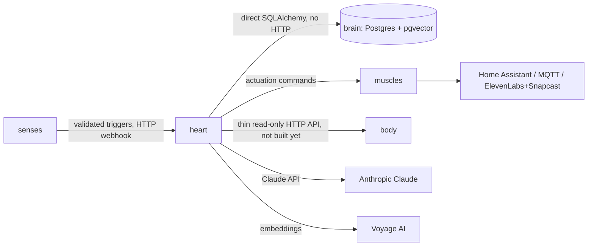

# Architecture

Technical reference for how THEA is built, grounded in what's actually in
this repo today — not what's aspirationally described. Every "not yet
implemented" claim below was verified by inspecting the actual source
files during the six-repo consolidation, not inferred from READMEs alone.

## Built vs. planned

| System | Real code | Scaffolding only |
|---|---|---|
| `brain` | `migrations/*.sql`, `app/models/*.py`, `generate_migrations.py`, `generate_models.py`, `seed/import_from_sheet.py`, `app/schema_reader.py` (all implemented during this consolidation) | `app/db.py`, `app/session_store.py`, `app/repositories/*.py` |
| `heart` | — | Everything (`app/main.py` and every submodule are empty) |
| `senses` | — | Everything; even `requirements.txt` was empty upstream — no dependency was ever pinned |
| `muscles` | — | Everything |
| `body` | `package.json`, `tsconfig.json`, `next.config.mjs` (config only) | Every `.tsx` file, `lib/api-client.ts` |
| `bones` (dissolved, see below) | — | Was entirely empty (Dockerfiles, compose, CI workflows all 0 bytes) before this consolidation authored real versions |

## Tech stack per system

- **brain** — Python. PostgreSQL 16+ with `pgvector`. SQLAlchemy 2.0 (Core-style) + psycopg3 for the (still-stubbed) direct-access layer. Redis for session/short-term state. Not a running service — see below.
- **heart** — Python 3.11+, FastAPI (webhook endpoints for inbound triggers), Anthropic Python SDK, APScheduler (proactive jobs), Voyage AI client (embeddings), direct SQLAlchemy connection to `brain`.
- **muscles** — Python 3.11+, FastAPI, `homeassistant-api`, `paho-mqtt`, ElevenLabs API client.
- **senses** — Python 3.11+ per its README and file extensions; no dependency was ever pinned. Documented intended stack: Porcupine (wake word), Silero VAD, faster-whisper (STT), pyannote.audio (diarization), a local vision model for motion/person detection.
- **body** — Next.js 15 (App Router), React 18, TypeScript.

## Data & control flow



- **senses → heart**: one direction only. `senses` publishes classified triggers (transcript/classification, not raw audio) to `heart`'s webhook endpoints. `senses` never talks to Postgres, Claude, or any reasoning API directly — it's a cheap, continuous filter gating expensive processing.
- **heart → brain**: a direct SQLAlchemy connection, not HTTP. Decision made explicitly in `brain`'s design docs: the context builder issues several queries per conversational turn, and that's latency-sensitive for a voice assistant expected to respond in real time.
- **heart → muscles**: dispatches actuation commands (device control, speech output); `muscles` reports back success/failure only, holds no independent state, makes no autonomous decisions.
- **heart → body**: meant to go through a thin, read-only HTTP API on `heart` (not built yet) rather than `body` holding direct DB credentials. `body` is the only system THEA functions entirely without.
- **Claude API**: called exclusively from `heart` (`app/claude/client.py`, currently an empty stub) — no other system talks to Claude directly. Tool routing (`app/claude/tool_dispatch.py`) is meant to route between MCP servers and native handlers, configured per `thea.tools`/`thea.integrations` rows.
- **Embeddings**: generated by `heart` via Voyage AI (`voyageai` client), not by `brain` — `brain` only stores and searches `vector(1536)` columns, it never calls an embeddings API itself.

## `brain`: schema-registry pattern

`brain`'s schema isn't hand-written SQL — it's generated from a self-describing
registry. Three tables (`public.schema_registry`, `public.table_registry`,
`public.column_registry`) define every schema, table, and column in the
database, including each column's Postgres type, nullability, and (via a
`(references schema.table.id)` marker in the description) foreign key
target. `brain/app/schema_reader.py` parses this registry out of
`THEA DB.xlsx` — the actual source-of-truth spreadsheet, which lives
**outside this repo** (a sibling of `thea/`, not inside it) and is never
committed, since it also contains real personal data.

Two generator scripts consume this:

- `brain/generate_migrations.py` emits `brain/migrations/000N_*.sql`,
  ordering `CREATE TABLE` statements within each schema via a topological
  sort on same-schema foreign keys, and applying `TYPE_OVERRIDES` for
  three known sheet-side type bugs (`config.name`, `config.temperature`,
  `config.do_not_disturb_start`/`end` — documented in the original
  `thea-brain` README's "Known open items" before this consolidation).
- `brain/generate_models.py` emits matching SQLAlchemy models in
  `brain/app/models/*.py`, one module per schema.

Both are idempotent — re-running against an unchanged workbook reproduces
byte-identical output (`generate_migrations.py --check` verifies this).

`thea.memories` is a hardcoded fallback in both generators, not sheet-driven
— it isn't in the registry yet (a known, pre-existing gap noted in the
original README). It uses `vector(1536)` to stay consistent with every
other embedding column, rather than the `vector(1024)` it used to have
before this regeneration.

**Seed data**: `brain/seed/import_from_sheet.py` extracts the sheet's
actual populated rows (THEA's config, her system prompts, the user's
identity profile, wardrobe/environment inventory) into
`brain/seed/local_seed.sql`. That file is gitignored and must never be
committed — only the schema *structure* is version-controlled. See
`brain/seed/README.md`.

**`brain` is not a docker-compose service.** Since `heart` connects to
Postgres directly, `brain/` is a Python package (imported by `heart` as a
workspace dependency) plus a set of migration files — not a long-running
process. `brain/Dockerfile` reflects this: it's a thin `psql` wrapper used
only by the one-shot `migrate` compose service, not an application image.

## Python tooling: `uv` workspace

`heart`, `muscles`, and `senses` are members of a `uv` workspace rooted at
the repo root (`pyproject.toml`, no root `[project]` table — a "virtual"
workspace, since the root itself isn't a package). `brain` is also a
workspace member so that `heart` can depend on it directly:

```toml
# heart/pyproject.toml
dependencies = [..., "brain"]
[tool.uv.sources]
brain = { workspace = true }
```

This replaces what used to be a fragile relative path
(`pip install -e ../steve-brain`, referencing both a stale pre-rename name
and a sibling-directory layout that a monorepo merge would have broken
outright). `muscles` and `senses` join the workspace for shared
tooling/lockfile consistency only — they have no actual code dependency on
`brain` or each other, consistent with not forcing unrelated services into
a shared dependency tree.

`body` (the only JS/TS system) stays outside the `uv` workspace with its
own `package.json`; no JS workspace tool was introduced since there's only
one JS system today.

**Known follow-up**: `brain`'s installable package currently exposes its
code as a top-level `app` module (via `[tool.hatch.build.targets.wheel]
packages = ["app"]`), and every other service also uses `app/` as its own
internal folder name. This is harmless today since nothing has real
imports yet, but should be disambiguated (e.g. renaming `brain`'s
installed module, or moving to a `src/` layout) before real code starts
importing across that boundary.

## Git history: preserved, but not `--follow`-able

Each of the six source repos' full commit history (author, date, message,
and content — 37 commits total) is preserved and reachable from `main` via
`git log --oneline` / `git log --all`. The merge technique used
(`git merge -s ours --no-commit` + `git read-tree --prefix=<dir>/`, since
`git filter-repo` wasn't available) lands each repo's commits as real
ancestors of the merge commit that introduced its subdirectory.

One caveat: because each file's path changed at the exact moment it was
merged (e.g. `README.md` → `brain/README.md`), `git log --follow` and
`git blame` can't automatically bridge that rename — they see the file as
"added" at the merge commit and stop there, since git's rename detection
doesn't cross merge boundaries this way by default. The pre-merge history
is still fully there; finding it just requires `git log --all` or knowing
to look at the merge commit's second parent (e.g. `git log <merge-sha>^2`)
rather than relying on `--follow` from a current file path.

## Naming: the STEVE → THEA rename

The product was renamed from "STEVE" to "THEA" at some point before this
consolidation, but the rename was incomplete in code — READMEs said
"THEA" while `thea-heart`'s dependency comment, `thea-brain`'s Postgres
schema (`steve.*`), its model file (`app/models/steve.py`), and
`thea-body`'s `package.json` (`"name": "steve-body"`) still said "steve".
This consolidation finishes the rename: the regenerated schema uses
`thea.*` throughout (confirmed against `THEA DB.xlsx`, which already used
`thea.config`/`thea.prompts`/etc.), `steve.py` became `thea.py`, and
`body`'s package name is `thea-body`.

## Why `bones` dissolved instead of becoming a folder

`thea-bones` wasn't a runtime service — it was connective tissue (Docker,
compose, CI) that has to span every other service. Keeping it as its own
top-level folder in the monorepo created two real problems:

1. GitHub Actions only reads workflows from `.github/workflows/` at the
   repo root — CI config couldn't live nested inside a `bones/` folder
   regardless of where anything else went.
2. Centralizing all five Dockerfiles in one folder means that folder has
   to track every other service's build details — more coupling than a
   monorepo needs. Each service's Dockerfile now lives next to the code
   it builds instead.

So `bones` is dissolved: its Dockerfiles moved into their respective
service folders, and its compose/CI files moved to the root locations
they had to live at anyway. This is consistent with the anatomical
metaphor if you push on it a little — bones are the structure the other
organs attach to, not a separate limb. The original `thea-bones` README
(including target deploy hardware notes — a Beelink SER7 or Intel NUC 13
Pro) is preserved at `docs/archive/thea-bones-original-README.md`.

None of `thea-bones`' Dockerfiles or compose files had any actual content
before this consolidation (all 0 bytes) — there was no working setup to
migrate, only the service list and sibling-directory build-context
convention (`../thea-heart`, etc.) to translate into in-repo relative
paths (`./heart`, `./brain`, etc.), which `docker-compose.yml` now does.

## Local dev: what `docker compose up` actually does today

Per the scope decision made during this consolidation (infra-only, no
placeholder application code): `postgres`, `redis`, and the one-shot
`migrate` job will come up healthy. `heart`, `muscles`, `senses`, and
`body` build successfully (dependency install only) but have nothing to
run yet — their containers will fail to start or crash-loop until real
application code exists. This is intentional and documented inline in
each `Dockerfile`, not a regression to fix.

## Known documentation/reality gaps (flagged, not silently fixed)

A few things the original repos' READMEs claimed didn't match what was
actually on disk, discovered while consolidating:

- `thea-brain`'s README said it was "the only repo with real code so
  far... migrations, connection layer, session store, and two
  representative repositories exist." Only the 5 migration files were
  real; `db.py`, `session_store.py`, and every repository file were empty
  stubs. (This consolidation adds the schema generator scripts as real
  code, per the user's explicit direction — the repository/session-store
  layer is still unimplemented.)
- `thea-body`'s README describes `layout.tsx` and each `page.tsx` as
  needing minimal placeholder content (`return null`) rather than being
  fully empty, since Next.js's App Router requires a valid default export
  just to build — but the actual files are 0 bytes, contradicting the
  README's own stated reasoning. Left as-is per the infra-only scope
  decision; `next build` will fail until this is addressed.
- `thea-senses`' README describes a full tech stack (Porcupine, Silero
  VAD, faster-whisper, pyannote.audio) that was never reflected in
  `requirements.txt` (empty). `senses/pyproject.toml` intentionally
  leaves dependencies unpinned rather than guessing versions for
  libraries that were only ever described in prose.

## `hermes-agent` reference

A local, read-only clone of `NousResearch/hermes-agent` was kept alongside
the six THEA repos purely as architectural reference during design and
consolidation — it was never merged into this repo or added as a
dependency. Patterns worth noting as inspiration for THEA's own
not-yet-built systems:

- **Platform-adapter interface** (`gateway/platforms/base.py`) — an
  abstract base class that Telegram/Discord/WhatsApp adapters all
  implement. A plausible model for `senses`' input channels (wake word,
  ambient audio, vision) as a common interface `heart` consumes uniformly.
- **String-keyed toolset registry** (`toolsets.py`) — named toolsets
  composed from a shared master tool list, resolved dynamically per
  session. A plausible model for `heart`'s planned tool routing
  (`app/claude/tool_dispatch.py`), which is meant to route between MCP
  servers and native handlers per `thea.tools`/`thea.integrations`.
- **Mixin-based state/search separation** (`hermes_state*.py`) — a
  SQLite-backed session state class with full-text search added as a
  separate mixin. A plausible model for how `brain`'s still-unimplemented
  `session_store.py` and `memory_repo.py` could be structured.
- **Forked-background-agent pattern** (`agent/curator.py`) — a
  subordinate agent spawned for a side task with isolated state and
  credentials, run on an inactivity trigger rather than a cron daemon. A
  plausible model for how `heart` might eventually delegate to `muscles`
  or run its own proactive scheduler jobs without touching the main
  session's prompt cache.

None of this code was copied — it's referenced here as design inspiration
for systems that don't exist yet.
