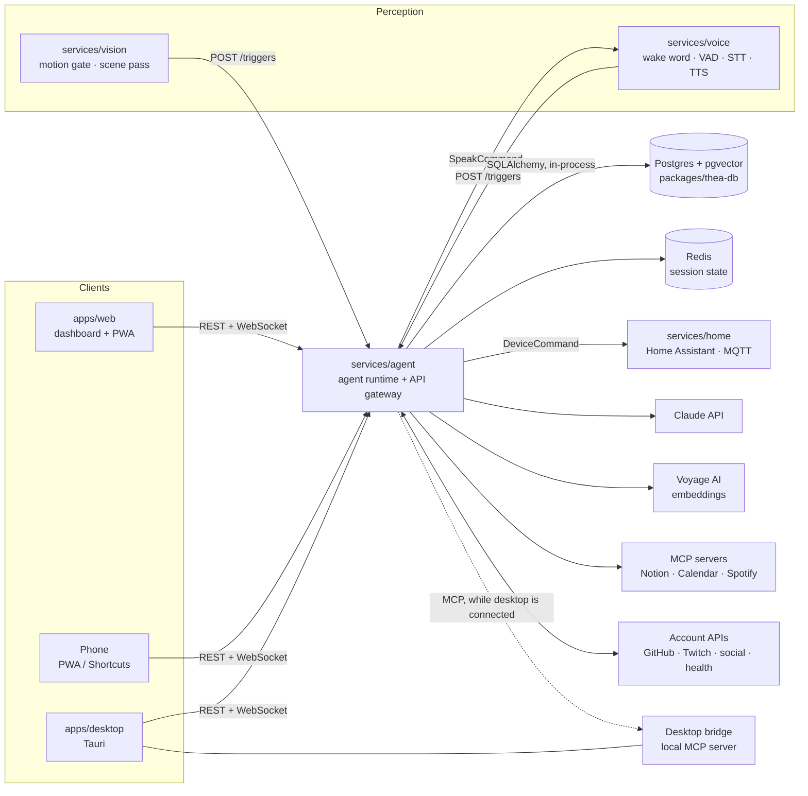

# Architecture

## System map



## Boundaries (the rules that keep this sane)

| Rule | Why |
|---|---|
| **Only `agent` calls an LLM.** | One place for prompts, caching, cost and safety. ([ADR 0003](decisions/0003-claude-only-from-agent.md)) |
| **Only `agent` touches the database.** It imports `thea_db` directly, with no HTTP hop. | Context assembly runs several queries per voice turn, so latency matters. Clients read through the agent's API, so no browser ever holds DB credentials. ([ADR 0004](decisions/0004-agent-owns-the-database.md)) |
| **Perception services filter; they don't think.** Voice and vision send transcripts and labels, never raw audio or video. | Cheap always-on gates in front of expensive reasoning, and private by construction. |
| **Actuators obey; they don't decide.** `home` and voice output execute commands and report success or failure. They hold no state. | Every decision is traceable to one place. |
| **All cross-service messages are defined in `thea_contracts`.** | Producers and consumers can't drift. |
| **Behavior is data, secrets are env.** | Change THEA's model, voice or DND window by editing `thea.config`, not by redeploying. ([ADR 0008](decisions/0008-env-for-secrets-only.md)) |

## Repository layout

```
apps/        things a person looks at        web (Next.js PWA), desktop (Tauri)
services/    long-running processes          agent, voice, vision, home
packages/    libraries services import       thea-db, thea-contracts
infra/       deployment-only assets          migrate image, deploy notes
docs/        you are here
```

Why this shape: [ADR 0001](decisions/0001-monorepo-layout.md).

## Services

| Service | Port | Package | Responsibility |
|---|---|---|---|
| `agent` | 8000 | `thea_agent` | Agent loop, context building, Claude, tool routing (native + MCP), memory extraction, proactive scheduler, and the public API every client uses |
| `voice` | 8010 | `thea_voice` | Mic input: VAD → wake word / relevance → STT → speaker ID → trigger. Speaker output: TTS → Snapcast room routing |
| `vision` | 8020 | `thea_vision` | Camera input: motion/person gate → (only if flagged) vision-language summary → trigger |
| `home` | 8030 | `thea_home` | Executes `DeviceCommand`s against Home Assistant / MQTT / Kasa |
| `web` | 3000 | — | Talk screen, memory browser, logs, health. Installable on a phone as a PWA |
| `desktop` | — | — | Native window for the web UI, a global push-to-talk shortcut, and the desktop bridge |

`thea-db` is **not** a service. It's a library plus SQL migrations, applied by
the one-shot `migrate` compose job.

### Inside the agent

```
thea_agent/
├── main.py            app factory
├── core/              settings (secrets only), logging (UTC), bearer auth
├── api/v1/            HTTP + WebSocket surface (see api.md)
├── channels/          Channel ABC + adapters: web, phone, voice, desktop
├── runtime/           turn loop, context builder, prompt loader, intent router, output dispatch
├── llm/               the Claude client (the only one in the repo)
├── tools/             registry, MCP connections, native tools, desktop tools
├── memory/            retrieval, post-turn extraction, embedding writer
├── integrations/      Integration ABC + adapters: calendar, GitHub, Twitch, social, Spotify, health
├── stats/             collectors + aggregators behind the dashboard and the get_stats tool
└── scheduler/         proactive jobs: morning brief, stale-data check, daily synthesis
```

A turn, end to end:

1. A message arrives through a **channel** (typed in the web app, a voice
   trigger, a phone shortcut).
2. The **intent router** decides: is it a fast-path command ("lights off")
   that goes straight to a tool, or does it need full reasoning?
3. The **context builder** assembles the prompt in cache-friendly order:
   static persona (`thea.prompts`) → stable profile (`identity.*`) → retrieved
   memories (`thea.memories`, pgvector) → session history (Redis) → the new
   message.
4. The **loop** calls Claude with the tools the **registry** says are available.
   It runs tool calls (asking for confirmation where `requires_confirm` is set)
   and repeats until there's a final answer.
5. **Output dispatch** sends the reply back over the originating channel, and
   to the voice service if it should be spoken.
6. After the conversation, **memory extraction** (fast model) distills durable
   facts, and the **writer** embeds them (Voyage AI) into `thea.memories`.

Two invariants come from Hermes:
- The system prompt is byte-stable for the life of a conversation, so prompt
  caching keeps working.
- User/assistant messages strictly alternate.

See [reference/hermes-agent.md](reference/hermes-agent.md).

## Tech stack

| Area | Choice |
|---|---|
| Languages | Python 3.12 (services, packages), TypeScript (apps), Rust (Tauri shell only) |
| Python tooling | `uv` workspace, ruff, mypy (strict), pytest |
| API | FastAPI + Pydantic v2, uvicorn |
| LLM | Anthropic Claude via the official SDK (prompt caching, tool use, MCP) |
| Embeddings | Voyage AI, 1536 dimensions |
| Database | PostgreSQL 16 + pgvector, SQLAlchemy 2.0, psycopg 3 |
| Session state | Redis 7 |
| Scheduling | APScheduler |
| Tools / integrations | MCP (Model Context Protocol) servers + native handlers |
| Voice | Porcupine (wake word), Silero VAD, faster-whisper (STT), pyannote (speakers), ElevenLabs (TTS), Snapcast (multi-room) |
| Vision | OpenCV + a small YOLO model as the gate; a vision-language model for the scene pass |
| Home | Home Assistant REST/WebSocket, Mosquitto MQTT |
| Web | Next.js 16 (App Router), React 19, Tailwind CSS 4, pnpm |
| Desktop | Tauri 2 |
| Run / deploy | Docker Compose; a home server (Beelink SER7 / NUC 13 Pro); Tailscale for remote access |
| CI | GitHub Actions |

## Design docs by capability

This page is the system map. The detail lives next to the capability:

| Capability | Doc |
|---|---|
| What she's for, and every requirement | [vision.md](vision.md) |
| How she sounds | [persona.md](persona.md) |
| How she remembers (Redis + Postgres) | [memory.md](memory.md) |
| How she decides, how fast, how much autonomy | [agent-runtime.md](agent-runtime.md) |
| Mics, wake word, "is he talking to me?", cameras, home control | [ambient-and-home.md](ambient-and-home.md) |
| Accounts and phone | [integrations.md](integrations.md) |
| Stats, habits and the dashboard | [stats-and-dashboard.md](stats-and-dashboard.md) |
| What to build, in order | [implementation-plan.md](implementation-plan.md) |
