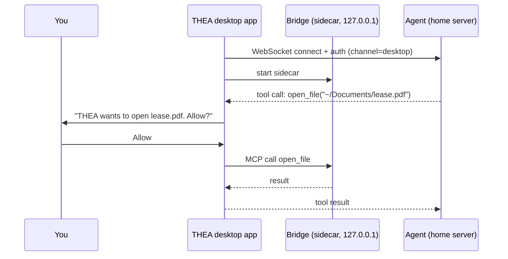

# Desktop

"Desktop access" means two separate things, and THEA needs both:

1. **THEA on your desktop:** a native app with a window, a tray icon and a
   global push-to-talk shortcut.
2. **THEA using your desktop:** the agent can open apps and files, read the
   screen and run commands on your PC, with your permission.

Both live in `apps/desktop` (Tauri 2). See [ADR 0006](decisions/0006-tauri-desktop.md).

> **Status:** scaffold. The Tauri config and Rust entrypoint exist but haven't
> been built yet (that needs Rust). The bridge is design only.

## 1. The app

- A small Rust shell around a webview that loads the **same UI as `apps/web`**.
  There's one frontend for browser, phone and desktop.
- In development it loads `http://localhost:3000`. Packaged builds point
  `build.frontendDist` at the THEA server.
- Planned: a tray icon (status at a glance), a global shortcut (for example
  `Ctrl+Alt+Space`) for push-to-talk from any app, and native notifications for
  pending approvals.

## 2. The desktop bridge

The agent runs on the home server, but your files and apps are on your PC. The
bridge closes that gap without exposing your PC to the network:

- The bridge is a **local MCP server**. Tauri starts and stops it with the app,
  and it binds to `127.0.0.1` only.
- The agent never connects to your PC. Tool calls travel down the desktop
  app's existing authenticated WebSocket, and the app relays them to the
  bridge. If the app is closed, THEA simply has no desktop tools; they're only
  offered to the model while a desktop channel is connected
  (`thea_agent/tools/desktop/`).
- **Every bridge action is confirmed** in the app's own window, regardless of
  `thea.tools.requires_confirm`. Later, "always allow" can be granted per tool
  and per path.
- Planned tool set, smallest first:
  1. open file / app / URL
  2. read clipboard and active window title
  3. screenshot
  4. run a shell command (always confirmed, with the command shown verbatim)
  5. computer use: mouse and keyboard control via screenshots

## Safety rules

- Bind to loopback only. Never expose the bridge port.
- Validate inputs on both sides: in the app (Rust) and in the sidecar.
- Keep a deny list of paths and commands (credential stores, `rm -rf`-style operations).
- Log every action to the agent's session log. You can review it in the web app.
- The sidecar dies with the app. Nothing runs in the background without the
  window.
