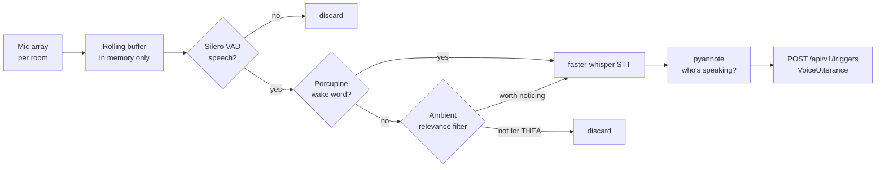

# Voice pipeline

Voice is THEA's main interface. The `voice` service owns **both directions**:
hearing (mic → transcript) and speaking (text → room speakers). The agent
decides what to say; voice decides nothing.

> **Status:** designed, not built. `services/voice` has the module layout,
> a `/health` endpoint, and an authenticated `POST /api/v1/speak` that returns 501.
> The model stack is an opt-in extra: `uv sync --package thea-voice --extra models`.

## Input: cheapest gate first



| Stage | Module | Runs | Notes |
|---|---|---|---|
| Rolling buffer | `buffer.py` | always | A few seconds in RAM, so the words *before* the wake word aren't lost. Never written to disk. |
| VAD | `input/vad.py` | always | Tiny CPU model. Everything below runs only when someone is talking. |
| Wake word | `input/wake_word.py` | on speech | Porcupine with a custom "Hey THEA" keyword (`thea.config.wake_word`). |
| Relevance filter | `input/relevance_filter.py` | on speech without the wake word | Decides whether ambient speech is addressed to THEA or worth noticing. Mostly discards. |
| STT | `input/stt.py` | on a trigger | faster-whisper, run locally. Only the transcript leaves this service. |
| Speaker ID | `input/diarization.py` | on a trigger | An unknown voice sets `speaker=None`, and the agent may switch to `privacy_mode` (no personal details out loud). |
| Publish | `publisher.py` | on a trigger | `VoiceUtterance{transcript, room, speaker, confidence}` → agent. |

## Output: the agent says something

```
agent → POST /api/v1/speak {text, rooms[], voice?} → output/tts.py (ElevenLabs) → output/snapcast.py → room speakers
```

- `rooms` empty means "wherever the user is". The agent works out presence and
  passes it in. Voice doesn't detect presence.
- `voice` defaults to `thea.config.voice`. Put a local TTS (for example Piper)
  behind the same interface as an offline fallback.
- While THEA is speaking, input should mute the wake word for that room, so
  she doesn't trigger herself.

## Push-to-talk from a client

The web, phone and desktop apps don't go through this service for typed chat.
For **held-button voice** they stream mic audio over the agent's WebSocket
(`/api/v1/ws`), and the agent forwards it for STT. The response comes back as
text and, optionally, synthesized audio. That keeps one auth boundary (the
agent) for everything outside the house.

## Latency budget

The goal is about 1.5 s from the end of speech to the first audio:

| Step | Budget |
|---|---|
| End-of-speech detection (VAD) | 300 ms |
| STT (faster-whisper, small/medium on CPU, or GPU) | 300–500 ms |
| Agent: context + first token (Claude, prompt-cached) | 500–700 ms |
| TTS first chunk (streaming) | 200–300 ms |

Ways to stay inside it:
- Stream everything (LLM tokens into TTS chunks).
- Use the intent router's fast path for device commands.
- Never block on memory extraction, which runs after the reply.

## Hardware

- **Mics:** one ReSpeaker-style USB mic array per room (far-field, with
  on-board beamforming and echo cancellation).
- **Speakers:** any Snapcast client (a Raspberry Pi + speaker per room).
- **Host:** the home server. faster-whisper benefits a lot from a GPU, but
  `small.en` runs acceptably on a modern CPU.

## Framework

The stage-per-module layout follows the frame-pipeline model used by
[Pipecat](https://github.com/pipecat-ai/pipecat): audio frames flow through
processors. Adopting Pipecat itself for the pipeline (it has Silero, Whisper
and ElevenLabs integrations and a FastAPI WebSocket transport) is the
recommended first step when building this service. See
[ADR 0005](decisions/0005-voice-stack.md).
